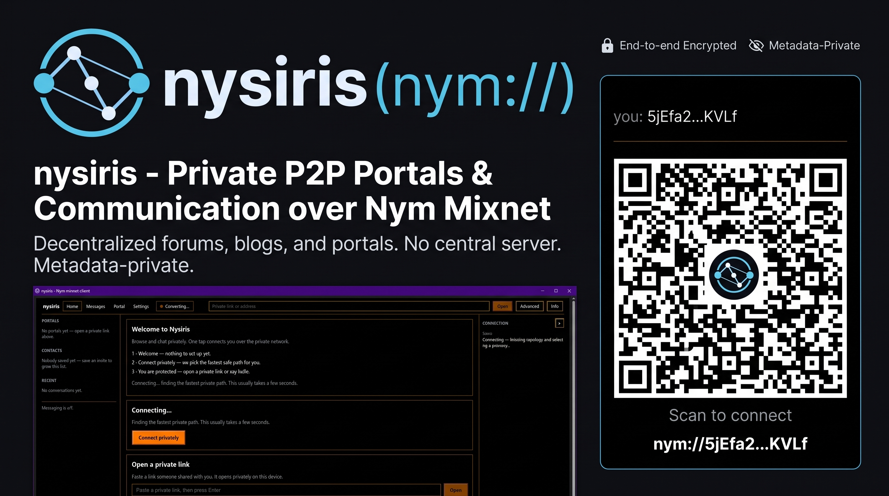
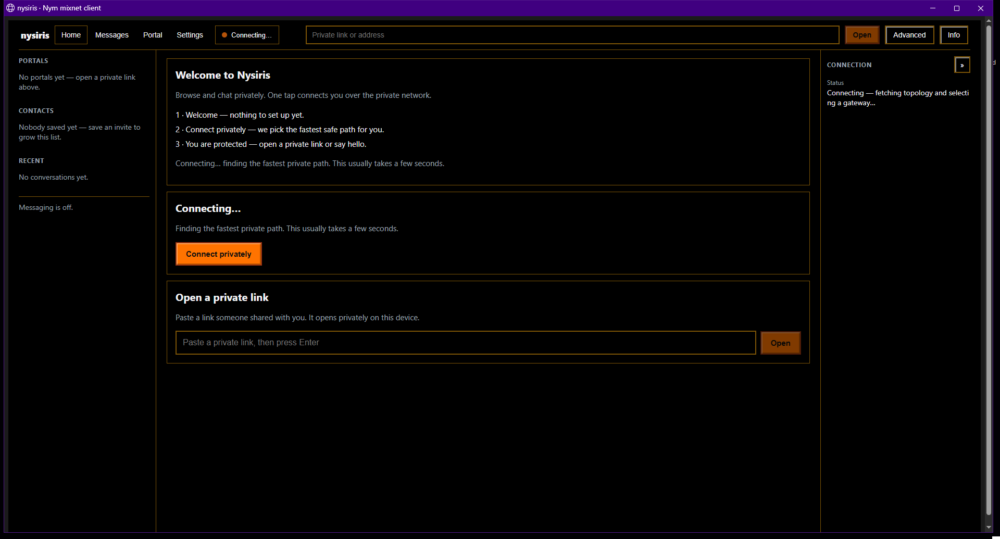
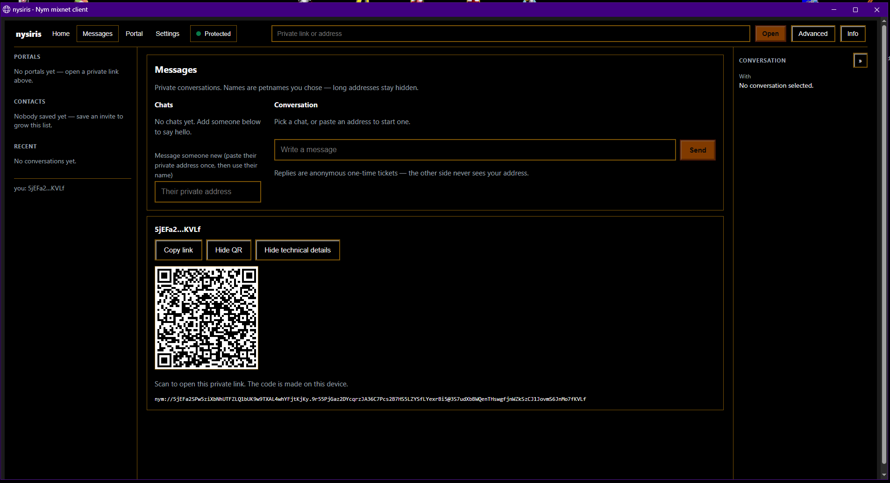
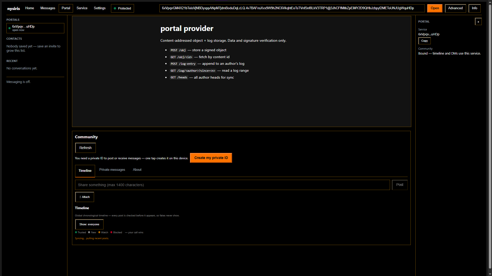

# Nysiris

> ⚠️ **Experimental / pre-audit.** This repository is under active development
> and has **not** had an independent security audit. The Sphinx core in
> `crates/` is a reference implementation, never production crypto. Do not
> rely on it for high-stakes anonymity yet — see the
> [threat model](#threat-model-short-version) and
> [`docs/05-security.md`](docs/05-security.md) for what is and isn't protected.

Nysiris is a private browser for the **Nym mixnet**: a cross-platform client
(web / PWA / Android / desktop) plus the pieces to **host your own service** on
the mixnet. It gives you a calm, everyday UI — private links, a community
timeline with end-to-end encrypted DMs, and a leak-guarded tunnel — while the
mixnet hides **who talks to whom and when** from network observers. Formerly
`fly-protocol`; renamed, nothing else moved.

[](https://github.com/odelyzid/Nysiris/actions)
[](LICENSE)
[](https://nysiris.tribewarez.com/)
[](https://github.com/odelyzid/Nysiris/wiki)

🌐 **[nysiris.tribewarez.com](https://nysiris.tribewarez.com/)** · 📖 **[Documentation wiki](https://github.com/odelyzid/Nysiris/wiki)**

> **Status:** foundations, hosting, browser client, social/DMs, trust
> indicators, desktop packaging, and security analysis complete, with the
> documented controls enforced in code and tests.
> * Reference Rust workspace: **113 tests pass** (the soak test is ignored by
>   default).
> * Browser PWA + social logic: **203 `node --test` tests pass** (0 skipped
>   when `node_modules` are present — and the CI gate runs them with
>   dependencies installed, so the @noble crypto constructions gate too).
> * Service hosting: runnable providers + `nysiris` CLI + hybrid compose +
>   gateway assets.
> * Build system: `./build.sh` for Rust / web / Android / services / desktop /
>   Windows / check, plus CI.
> * The `services/*` builds depend on Nym's own packages and are not compiled by
>   the fast `./build.sh check` loop.
> * The protocol/transport layer is being extracted into
>   [`TribeWarez/nysiris-core`](https://github.com/TribeWarez/nysiris-core) and
>   is vendored as the `core/` submodule (pinned `v0.1.3`); the five crates are
>   published on crates.io as `0.1.3` — see
>   [Build on Nysiris-Core](#build-on-nysiris-core).

## One protocol, two projects

Nysiris is split along a deliberate seam, so the protocol can be reused without
carrying the app:

| | **Nysiris** (this repository) | **[Nysiris-Core](https://github.com/TribeWarez/nysiris-core)** |
|---|---|---|
| Role | the product | the reusable base |
| Scope | browser PWA, Android/desktop shells, service providers, `nysiris` CLI, reference Sphinx | chat identity, sealed DMs, encrypted history, rooms, `Transport` trait, `nym-sdk` adapter |
| For | private mixnet browsing + self-hosting | your own mixnet app, bot, relay or microservice |
| Build | `./build.sh check` · `web` · `services` | `cd core && cargo test --workspace --locked` |
| Version | `VERSION` (app releases) | independent tags; `core/` pins `v0.1.3` |

Both sides implement the same wire contract (DM envelope, history binding, room
keys), but the dependency only ever points one way: **Nysiris-Core must not
depend on this repository.**

Two reference consumers ship today: this app and
**[NCC](https://github.com/TribeWarez/ncc)** (`Nysiris Chat Commander`, PySide6 +
`ncc-daemon`), a native desktop chat client built on the same crates — a working
example of the “build your own app on the base” path.

## Build on Nysiris-Core

If you are not building Nysiris, the base is the useful part. Nysiris-Core is an
Apache-2.0 Rust workspace with no UI, no wallet or token economics, and no
dependency on this repository. It is meant for:

* native desktop/mobile clients that need mixnet delivery and end-to-end DMs;
* bots, relays, notifiers and other **microservices** reachable by Nym address;
* bridges that want sealed local history plus a `Transport` trait to plug in
  their own network (Nym today, something else tomorrow);
* tests and CI that need a deterministic in-memory transport.

What you get (all crates are versioned together, `0.1.3`):

* `nysiris-core` — identity, signed DM inner envelope, sealed DM crypto,
  contacts, messages, sealed files, `Transport` trait;
* `nysiris-chat-history` — encrypted append-only flat-file history (no SQLite);
* `nysiris-chat-core` — 1:1 chat engine + capability-key rooms with client-side
  fan-out;
* `nysiris-transport-nym` — `nym-sdk` adapter behind the `nym` feature (an
  explicit unavailable stub without it, so tests stay fast);
* `nysiris-testkit` — `MemoryTransport` and fixtures.

They are on crates.io — add what you need:

```toml
[dependencies]
nysiris-core = "0.1.3"
nysiris-chat-core = "0.1.3"
nysiris-chat-history = "0.1.3"

[dependencies.nysiris-transport-nym]
version = "0.1.3"
features = ["nym"]          # real nym-sdk adapter; heavy first build

[dev-dependencies]
nysiris-testkit = "0.1.3"
```

Working against unreleased changes? Depend on the tag (or the `core/` submodule
vendored here):

```toml
nysiris-core = { git = "https://github.com/TribeWarez/nysiris-core", tag = "v0.1.3" }
```

A minimal engine — send a sealed DM and let the transport deliver it:

```rust
use std::sync::Arc;

use nysiris_chat_core::ChatEngine;
use nysiris_chat_history::History;
use nysiris_core::ChatIdentity;
use nysiris_testkit::MemoryTransport;

fn main() -> nysiris_core::Result<()> {
    let identity = ChatIdentity::generate();
    let transport = Arc::new(MemoryTransport::new());
    let history = History::open("state/history", [7u8; 32])?;

    let mut engine = ChatEngine::new(
        identity,
        Vec::new(),          // contacts
        Vec::new(),          // groups
        history,
        transport.clone(),
        "<your nym address>",
    );

    let peer_pubkey_hex = "<peer ed25519 pubkey>";
    let msg = engine.send_dm(peer_pubkey_hex, "hello over the mixnet")?;
    println!("queued {}", msg.msg_id);
    assert_eq!(transport.len(), 1);   // sealed payload ready to send
    Ok(())
}
```

The example uses `nysiris-testkit`'s in-memory transport so it runs anywhere;
swap in `NymTransport::connect(dir, gateway)` with `features = ["nym"]` for real
delivery (`address()` and `recv_timeout()` drive the receive loop).

Bring your own transport — the core never opens a socket:

```rust
use nysiris_core::error::Result;
use nysiris_core::transport::Transport;

struct MyTransport { /* ... */ }

impl Transport for MyTransport {
    fn name(&self) -> &'static str { "my-transport" }

    fn send(&self, recipient: &str, payload: Vec<u8>) -> Result<()> {
        // deliver `payload` to the Nym address in `recipient`
        Ok(())
    }
}
```

Honest limits: pre-1.0 API, not independently audited crypto (see the core
`SECURITY.md`), and no financial features — Nym is the transport, not the
product. Full crate map, wire invariants and migration state:
[`docs/14-nysiris-core.md`](docs/14-nysiris-core.md).

## What this project is not

Nysiris is a private browser and a set of self-hosting services. It is not a
crypto or DeFi product, and it has no financial features:

* No wallet, and no crypto asset management.
* No token. There is no Nysiris token and no Nysiris airdrop.
* No swap, exchange, or trading.
* No staking, bonding, or delegation.
* No yield or farming, and no in-app earn/rewards program.
* No token-gated UI, tiers, or paid unlocks.
* No crypto price, chart, or portfolio features.

Nothing in the app asks for a wallet connection, a seed phrase, a token balance,
or a payment. The cryptography here is for private communication — routing,
encryption, and signatures — not for finance.

## Transport note (Nym)

The Nym mixnet is used strictly as a transport and privacy layer: it hides who
talks to whom and when, it carries fixed-size packets, and SURBs let a service
reply without learning the client's address. That is its whole role here.

The public Nym network has its own token economics — a $NYM token, node
staking, operator rewards, and credentials for clearnet exits. That is Nym's,
not Nysiris's. This repository does **not** implement $NYM, staking, bonding,
node-operator rewards, or credential purchase flows, and it does not expose or
depend on Nym token economics inside the application:

* No token, staking, or bonding logic in the client or the providers.
* No node-operator rewards, payouts, or accounting.
* No credential purchase, resale, or top-up flows.
* No wallet, balance, or price display anywhere in the UI.

Running and bonding a Nym node (see `services/gateway/` and
`docs/04-hosting-services.md`) is standard Nym operator work done with Nym's own
tools and wallet, outside the Nysiris application.

## What works vs what is experimental

| Area | State |
|---|---|
| PWA: tunnel, leak guard, Nym-address messaging, `fetchNym` (+ parallel tagged requests) | Works (mainnet-verified delivery + SURB reply) |
| Community timeline, threads, E2E DMs (signature-authenticated dead-drop reads), trust dots, petnames, invites, encrypted attachments | Works against a `nysiris-social` provider you run |
| Providers, hybrid bridge, portal store, `nysiris` CLI | Works; you operate them (see `services/`) |
| Nysiris-Core as a dependency (crates.io `0.1.3`) | Works: 1:1 DMs + rooms, encrypted history, `nym-sdk` transport — pre-1.0 API; docs.rs coverage 100% |
| Linux `.deb`, Windows zip | Works; built by CI on every release tag |
| Android (Capacitor 8, targetSdk 36), MV3 extension | Signed APK/AAB per release (F-Droid / sideload; no proprietary deps); extension is a scaffold |
| `sphinx-core` crypto | Reference/educational only — never use in production |

## Quick start

Prerequisites: a stable Rust toolchain and Node 24 (the version CI uses for the
browser client and its type-stripping tests).

```bash
git clone --recurse-submodules https://github.com/odelyzid/Nysiris.git
cd Nysiris
# already cloned? git submodule update --init --recursive

./build.sh check     # toolchain sanity: fmt + clippy + 113 Rust + 203 web tests
./build.sh web       # build the browser PWA into web/dist
```

The `core/` submodule is the extracted protocol/transport workspace
([Nysiris-Core](https://github.com/TribeWarez/nysiris-core)). It is **not** a
workspace member, so the fast `check` loop does not build its `nym-sdk`
toolchain; build it on demand with `cd core && cargo test --workspace --locked`.

Run the client from the built bundle (serve `web/dist` with any static file
server) or with the dev server:

```bash
cd web && npm install && npm run dev
```

Hosting a service on the mixnet (echo / portal / social providers, the hybrid
bridge, and a self-hosted entry gateway) is covered in
[`docs/04-hosting-services.md`](docs/04-hosting-services.md) and the per-service
READMEs under `services/`. The [`nysiris` CLI](docs/13-sdk-cli.md) is the
one-command path:

```bash
./build.sh services nysiris-cli    # build the CLI
cd services/nysiris-cli
cargo run --release -- host echo                    # run a mixnet service
cargo run --release -- host files --web-root ./public
cargo run --release -- fetch <id.enc@gw> --path /   # test it over the mixnet
```

```bash
./build.sh services            # build + test every standalone provider
./build.sh services social     # or just one
```

The live-network proof — real delivery and a SURB reply against mainnet — is:

```bash
./build.sh acceptance
```

## Featured hidden services

Reach these from the Nysiris omnibox (`nym://<id>.<enc>@<gw>/path`), or with
the CLI: `nysiris fetch <address> --path /`. Addresses are shared out of band
on purpose — there is no global directory (`docs/05-security.md` §5.7).

| Service | Nym address |
|---|---|
| TribeWarez Portal | `nym://6BH3ALNQ9L39qsei6QjofNcRRdFydoq82UJ2KE3XTZnq.6vdcFysfmE4yXqsgn3hd2uPPpoE5kvkvot4tYqWWhvKJ@CcYinhLeFU8n6xs78FG6Rz3wvosGTCU2hLB1CZyfkMVe/` |
| Hidden Wiki | `nym://9LZZpXYkmwxvuo3JD7udjzuDUCTm9FmDUAnHQb8Hnq2u.8LHeYzMCs5DwVWFxbctuRKL4gqWQvyBnyJASfLYXCdQg@4cdgnckjRBAaaP4ds68YEJPRc78paC4YWMGBDUS8G57C/` |

Listed as-is: no endorsement, no uptime guarantee. Fetched HTML renders in a
sandboxed iframe (no scripts, no forms) — service pages are displayed, never
executed.

## Threat model (short version)

Mixing + cover traffic hide **who talks to whom and when** from network
observers (L1/L3), and services never learn client addresses (SURB replies).
DM dead-drops are destructive and **authenticated** — only the recipient key
can read them. It does **not** protect against a compromised endpoint, a
malicious service you choose to use, or timing correlation when cover traffic
is thin. Full analysis: [`docs/05-security.md`](docs/05-security.md).

## Read in this order

Prefer a rendered site? These docs are mirrored to the
[GitHub Wiki](https://github.com/odelyzid/Nysiris/wiki); the project site is
[nysiris.tribewarez.com](https://nysiris.tribewarez.com/).

1. [`docs/01-architecture.md`](docs/01-architecture.md) — system overview, two
   traffic modes, trust boundaries, browser/WASM constraints.
2. [`docs/02-addressing-and-routing.md`](docs/02-addressing-and-routing.md) —
   how "DNS" is replaced by cryptographic identities, the exact Sphinx
   construction (`alpha`, `beta`, `gamma`, `delta`), SURBs, diagrams.
3. [`docs/04-hosting-services.md`](docs/04-hosting-services.md) — pure mixnet
   provider, hybrid clearnet+mixnet, self-hosted gateway, with configs.
4. [`docs/03-browser-client.md`](docs/03-browser-client.md) — cross-platform
   client design, leak guard, CSP, Android packaging.
5. [`docs/05-security.md`](docs/05-security.md) — threat model (L1/L2/L3L/L3G,
   V1/V2/V3, P1/P2), tagging, timing, SURB hoarding/reuse, exit trust.
6. [`docs/08-hidden-services.md`](docs/08-hidden-services.md) — hidden-service
   abstraction: `nym://` URIs, envelopes, server dispatch, petnames, chunking.
7. [`docs/13-sdk-cli.md`](docs/13-sdk-cli.md) — hosting SDK (`nysiris-sdk`) and
   the `nysiris` CLI: `host`, `address`, `fetch`, `petname`, `doctor`.
8. [`docs/09-social.md`](docs/09-social.md) — nysiris-social: metadata-minimal
   microblog + E2E DMs, SQLite security, signature/E2E specs, operations.
9. [`docs/07-desktop-linux.md`](docs/07-desktop-linux.md) — Linux Mint / Debian
   desktop packaging (`.deb`, Electron, Tauri, Flatpak) and engine compatibility.
10. [`docs/14-nysiris-core.md`](docs/14-nysiris-core.md) — the extracted
    protocol/transport workspace (`core/` submodule), its boundaries and
    migration status.
11. [`docs/06-roadmap.md`](docs/06-roadmap.md) — phased plan with acceptance
   criteria.

## Build & verify

One entry point for everything:

```bash
./build.sh check              # fmt + clippy(-D warnings) + all tests + docs
./build.sh rust --release     # optimized workspace build
./build.sh rust --target aarch64-unknown-linux-gnu
./build.sh wasm               # sphinx-core -> wasm32 (optional)
./build.sh web                # install deps + build the PWA
./build.sh android            # TWA (Bubblewrap) or Capacitor
./build.sh services           # standalone Nym service crates
./build.sh soak               # heavy parser/route soak (release)
./build.sh acceptance         # live-network delivery + SURB reply (needs Nym toolchain)
./build.sh desktop            # Linux .deb (system Chromium); --electron for Electron
./build.sh windows            # Windows zip via MSYS2/MinGW or MSVC (see docs/12-windows.md)
./build.sh all                # rust + check + web
./build.sh clean [--deep]
./build.sh --help
```

Releases are cut from tags: `./build.sh bump <version>`, commit `VERSION`,
`git push origin v<version>` — CI builds the `.deb` + Windows zip and
publishes them with checksums (`.github/workflows/release.yml`).

`./build.sh check` runs **113 Rust tests** and **203 web unit tests** with zero
clippy warnings, validates the JSON manifests, and checks every relative link in
the docs. It runs offline (no `npm install`). CI runs it on every push/PR.

- **Fuzzing**: deterministic mutation fuzzing runs inside `check`; optional
  coverage-guided fuzzing is in `crates/sphinx-core/fuzz/` (nightly + cargo-fuzz).
- **Soak**: `./build.sh soak` runs 5,000 randomised routes/messages in release.
- **Live network**: `./build.sh acceptance` sends to self and replies over SURBs
  against mainnet. See `services/acceptance/README.md` for toolchain setup.

## What is implemented

| Path | What | Verification |
|---|---|---|
| `crates/sphinx-core/` | Reference Sphinx: header/blinding/filler/MAC/Lioness/SURB/address | `cargo test -p sphinx-core` |
| `core/` (submodule) | Extracted protocol/transport workspace: chat identity, sealed DMs, encrypted history, rooms, `Transport` trait, `nym-sdk` adapter (pinned `v0.1.3`, published as `0.1.3`) | `cd core && cargo test --workspace --locked` |
| `crates/sphinx-core/src/enforcement.rs` | Route policy, SURB single-use/expiry, reply budget, exit rotation, cover-traffic guardrail | 12 tests |
| `crates/bridge-guard/` | Open-proxy guards for the mixnet↔HTTP bridge | 8 tests |
| `crates/nym-hidden-service/` | Hidden-service abstraction: URIs, envelopes, dispatch, petnames, chunking | 13 tests |
| `crates/nysiris-sdk/` | Hosting SDK: `HostConfig`, `serve` harness, traversal-safe `StaticFiles`, curated re-exports | 11 tests |
| `crates/portal-data/` | Portal data model: content-addressed objects, append-only logs, LWW-map | 4 tests |
| `crates/portal-replication/` | Sync core: heads, want-lists, verified atomic apply | 12 tests |
| `crates/portal-reputation/` | PoW (anti-spam), local reputation scores, provider rate limits | 5 tests |
| `crates/provider-runtime/` | Shared hidden-service runtime: transport seam, request loop, PoW + rate guards, route plumbing | 15 tests |
| `crates/social-format/` | Byte-exact social wire format: signed envelope framing, attachment binding, size limits, PoW preimages | 15 tests |
| `crates/sphinx-core/tests/fuzz_parser.rs` | Deterministic mutation fuzzing of all parsers | 6 tests |
| `crates/sphinx-core/tests/soak.rs` | Randomised route/message soak (release) | `./build.sh soak` |
| `crates/sphinx-core/fuzz/` | Coverage-guided fuzzing targets (nightly) | `cargo +nightly fuzz run parse_packet` |
| `services/echo-provider/` | Pure-mixnet service provider (`nym-sdk` 1.21.x messaging) | Written against documented API; build in place |
| `services/acceptance/` | Live-network delivery + SURB reply harness | **Passed on mainnet**: delivery ≈7.6 s, SURB reply ≈7.1 s |
| `services/hybrid-bridge/` | Nym↔HTTP bridge + Caddy + Docker Compose, using `bridge-guard` | `docker compose config` + guard tests |
| `services/social/` | nysiris-social: signed-post microblog + E2E DM dead-drop (SQLite, `HiddenService`); encrypted attachments (content-addressed blobs, chunked + parallel upload); PoW + rate-limit hooks (`SOCIAL_POW_BITS`, `SOCIAL_RATE_PER_DAY`); signed dead-drop reads | 17 tests + `web/src/adapters/driving/social/` timeline UI |
| `services/portal-provider/` | Portal object/log store; PoW + rate-limit hooks (`PORTAL_POW_BITS`, `PORTAL_RATE_PER_DAY`) | 5 tests |
| `services/nysiris-cli/` | `nysiris` CLI + nym-sdk transport adapter: `host echo`/`host files`, `address`, `fetch`, `petname`, `doctor` | 9 parser tests + `./build.sh services` |
| `services/gateway/` | `nym-node` entry-gateway config, systemd, Nym operator bonding notes (outside the app) | Templates + operator steps |
| `web/` | React PWA: tunnel, `mixFetch`, Nym-address messaging, `fetchNym`, portal favourites, nysiris-social timeline, leak guard, runtime enforcement | 203 `node --test` tests + `npm run build` |
| `android/` | TWA/Capacitor guidance, manifest, network security config | Templates |
| `desktop/launcher/` | std-only Linux launcher: loopback static server + Chromium app window | 6 tests |
| `desktop/debian/` | `.deb` packaging (control, postinst, `.desktop`, icon) | Built + inspected; `./build.sh desktop` |
| `desktop/electron/` | Electron alternative (bundled Chromium) | Scaffold |
| `extension/` | MV3 desktop scaffold | Load unpacked after bundling |
| `build.sh` + `scripts/` | Rust / web / android / services / check build system | `check` runs offline |
| `.github/workflows/ci.yml` | CI | Runs `./build.sh check` |

## Nysiris-Core extraction status

The protocol and transport layer is being extracted from this repository into
[`TribeWarez/nysiris-core`](https://github.com/TribeWarez/nysiris-core): a
standalone Rust workspace that depends on neither this repository nor any
client. It is vendored here as the **`core/` submodule**, pinned to `v0.1.3`,
so the extracted code is reviewable from one checkout while the builds stay
decoupled.

| Crate | Responsibility |
|---|---|
| `nysiris-core` | chat identity, signed DM inner envelope, sealed DM crypto, contacts, message types, `Transport` trait, sealed files |
| `nysiris-chat-history` | encrypted append-only flat-file history (no SQLite) |
| `nysiris-chat-core` | 1:1 chat engine plus capability-key rooms with client-side fan-out over the transport trait |
| `nysiris-transport-nym` | real `nym-sdk` adapter behind the `nym` feature; an explicit unavailable stub by default |
| `nysiris-testkit` | in-memory transport and test fixtures |

Dependency direction (core sits in the middle, and must not depend on either
side):

```
Nysiris browser PWA ──wire──► Nysiris services ──┐
                                                 ├──► Nysiris-Core
NCC (PySide6 + ncc-daemon) ──────────────────────┘
```

[NCC](https://github.com/TribeWarez/ncc) is the native reference consumer and a
good template for third-party clients. Crate APIs and rustdoc:
[docs.rs/nysiris-core](https://docs.rs/nysiris-core),
[docs.rs/nysiris-chat-core](https://docs.rs/nysiris-chat-core),
[docs.rs/nysiris-chat-history](https://docs.rs/nysiris-chat-history),
[docs.rs/nysiris-transport-nym](https://docs.rs/nysiris-transport-nym).

**Migration status: partially extracted.** What moved is the native chat
protocol and Nym transport seam:

* chat identity (`ChatIdentity`), contacts, message types;
* the sealed DM construction — ed25519 identity → X25519, ephemeral DH,
  BLAKE2b-256 KDF, XChaCha20-Poly1305 — matching the browser client, with a
  signed inner envelope that binds `from`, `to`, `ts`, `msgId`, and body;
* encrypted history journals (flat files, filename bound as AEAD associated
  data);
* the `Transport` trait and the `nym-sdk` adapter, verified on mainnet.

What is still in this repository (and why):

| Still here | Why |
|---|---|
| `crates/sphinx-core` | reference Sphinx implementation + test vectors, never production crypto |
| `crates/social-format`, `services/social` | the social wire format and its provider are still service-side; `nysiris-social-protocol` is planned in core |
| `crates/nym-hidden-service`, `crates/provider-runtime`, `crates/nysiris-sdk` | hosting abstractions consume service crates that have not been extracted yet (`nysiris-service` is planned) |
| `web/src/mixnet/`, `web/src/application/dm.ts` | the browser client is TypeScript and uses `@nymproject/*`; consuming the Rust chat crates from the PWA needs a wasm build first |

Rules that keep the extraction clean:

* **The submodule is not a Cargo workspace member.** Its `nym-sdk` toolchain
  must not slow or couple to `./build.sh check`, and the crates publish
  independently (all five are on crates.io from `0.1.3`; the API is pre-1.0).
* **Consumers pin, they do not fork.** `Nysiris` must not depend on
  `nysiris-chat-core` and NCC must not depend on `Nysiris`; compatibility is a
  CI relationship across repositories, not a Cargo dependency.
* **Do not copy core code back.** Fix protocol/transport bugs in
  `nysiris-core`, bump the submodule pointer here, and re-run the consumer
  build.

```bash
git submodule update --init --recursive      # fetch core/ (pinned tag)
cd core
cargo fmt --check
cargo clippy --workspace --all-targets --locked -- -D warnings
cargo test --workspace --locked
bash scripts/check-nym-pins.sh                        # from-scratch Nym resolve
cargo check -p nysiris-transport-nym --features nym --locked   # heavy; real nym-sdk
```

To bump the pin: `git -C core fetch --tags && git -C core checkout vX.Y.Z`,
then commit the updated `core` pointer (and `.gitmodules` if the URL changes).
Full details, boundaries, and the remaining extraction checklist:
[`docs/14-nysiris-core.md`](docs/14-nysiris-core.md).

## Reference core

`crates/sphinx-core` is a faithful, tested mirror of Nym's `sphinx-packet`:

* X25519 key schedule + per-hop blinding, HKDF-SHA256 → 288 bytes
* AES-128-CTR header onion with the Sphinx filler
* HMAC-SHA256 (16-byte) header integrity
* Lioness (BLAKE2b + ChaCha) payload onion
* SURBs, Nym address parsing (`<id>.<enc>@<gw>`), path selection

```bash
./build.sh check
```

It produces a **regular packet of exactly 2413 bytes** (348 header + 2065
payload), matching the production network.

> ⚠️ **Not production crypto.** Real software must use Nym's audited packages:
> `@nymproject/mix-tunnel` / `mixFetch` / `sdk-full-fat` (browser),
> `nym-sdk` / `nym-sphinx` / `sphinx-packet` (Rust), `nym-client` /
> `nym-socks5-client` (standalone). This crate is for education, audit and test
> vectors.

## Releasing / versioning

`./VERSION` is the single source of truth for the application version. It drives
the `.deb` and Electron packages and is kept in sync with `web/package.json`
and `desktop/electron/package.json`.

```bash
./build.sh bump patch        # 0.1.6 -> 0.1.7
./build.sh bump minor        # 0.1.6 -> 0.2.0
./build.sh bump major        # 0.1.6 -> 1.0.0
./build.sh bump 1.2.3        # set an explicit version

./build.sh desktop                       # -> dist/nysiris_<version>_amd64.deb
./build.sh desktop --electron            # -> Electron .deb + AppImage
./build.sh web && ./build.sh android     # PWA / Android
./build.sh check                         # verify
```

`--app-version X.Y.Z` overrides the version for one build without changing
`./VERSION`.

> The Rust crates under `crates/` carry their own independent versions
> (`0.1.0`); `./VERSION` is the **application / package** version.

## Upgrading dependencies

| Component | Where | How |
|---|---|---|
| Rust toolchain | system | `rustup update` |
| Rust crates | `crates/*/Cargo.toml` | edit the version, then `cargo update` |
| Nym SDK (services) | `services/*/Cargo.toml` | `cargo search nym-sdk`, raise the version, rebuild |
| Nysiris-Core | `core/` submodule | `git -C core fetch --tags`, check out the new tag, commit the pointer; re-run `cd core && cargo test --workspace` and the consumer smoke test |
| Browser Nym SDK | `web/package.json` | `npm view @nymproject/mix-fetch version` (and `sdk-full-fat`), then `npm install` |
| Electron | `desktop/electron/package.json` | `npm install electron@latest electron-builder@latest --save-dev` |

`nym-sdk`, `nym-bin-common` and `nym-sphinx` are versioned **independently** on
crates.io (as of this writing `nym-sdk` 1.21.6 while `nym-bin-common` is
1.22.0), so raise them individually and re-read the API when you do — the
messaging API has changed between releases.

After any upgrade: `./build.sh check`, then `./build.sh acceptance` for anything
touching the network path.

## Layout

```
build.sh                 one entry point: rust | web | android | services | check | all | clean
scripts/                 modular build commands + doc/JSON validators
.github/workflows/       CI + release + wiki publishing
.github/                 community health: SECURITY, CONTRIBUTING, CODE_OF_CONDUCT, CHANGELOG
.agents/AGENTS.md        guidance for AI coding agents
core/                    nysiris-core submodule: extracted protocol + transport (not a workspace member)
crates/sphinx-core/      reference Sphinx + enforcement controls (workspace)
crates/bridge-guard/     open-proxy guards (workspace)
crates/nym-hidden-service/  hidden-service abstraction: URIs, envelopes, dispatch, petnames (workspace)
crates/nysiris-sdk/      hosting SDK: HostConfig, serve, StaticFiles, re-exports (workspace)
crates/portal-data/      portal objects + append-only logs (workspace)
crates/portal-replication/  sync core: heads, want-lists, verified atomic apply (workspace)
crates/portal-reputation/   PoW + local reputation + rate limits (workspace)
crates/provider-runtime/   shared hidden-service runtime (workspace)
crates/social-format/      byte-exact social wire format (workspace)
docs/                    architecture, addressing/routing, hosting, client, security, desktop, hidden-services, roadmap
services/                echo-provider, hybrid-bridge, portal-provider, social, acceptance, nysiris-cli (standalone) + gateway ops
web/                     React PWA client (TypeScript)
  src/domain/              pure rules/types (no React, no fetch, no storage)
  src/application/        use-cases / orchestration over the ports
  src/adapters/driving/   React components + UI hooks (shell / portal / social / shared)
  src/adapters/driven/    keystore, network, blob + portal-sync I/O
  src/shared/             cross-cutting UI helpers
android/                 Android packaging manifest + guidance
desktop/                 launcher, .deb + Windows packaging, Electron alternative
extension/               MV3 desktop scaffold
```

## Screenshots



### Tabs

| Home | Messages |
|---|---|
|  |  |



These contain no real addresses, contacts, or messages. Serve `web/dist` (or a
release package) to click through it yourself — more honest screenshots welcome.

## Community & license

- Site: [nysiris.tribewarez.com](https://nysiris.tribewarez.com/).
- Docs: [`docs/`](docs) · [GitHub Wiki](https://github.com/odelyzid/Nysiris/wiki).
- Contributing: [`.github/CONTRIBUTING.md`](.github/CONTRIBUTING.md) (start with `.agents/AGENTS.md`).
- Security reports: [`.github/SECURITY.md`](.github/SECURITY.md) — private advisories only.
- Conduct: [`.github/CODE_OF_CONDUCT.md`](.github/CODE_OF_CONDUCT.md).
- Changes: [`.github/CHANGELOG.md`](.github/CHANGELOG.md).
- License: [Apache-2.0](LICENSE) © 2026 odelyzid (tribewarez).
